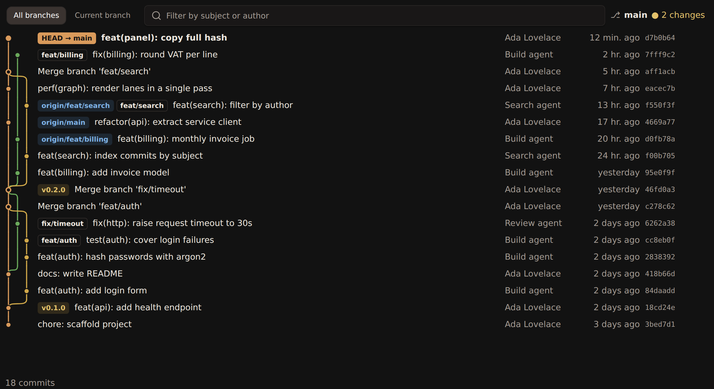
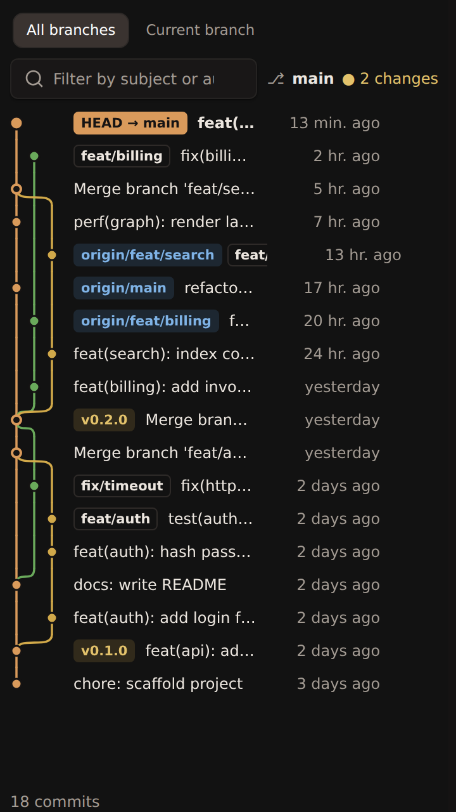
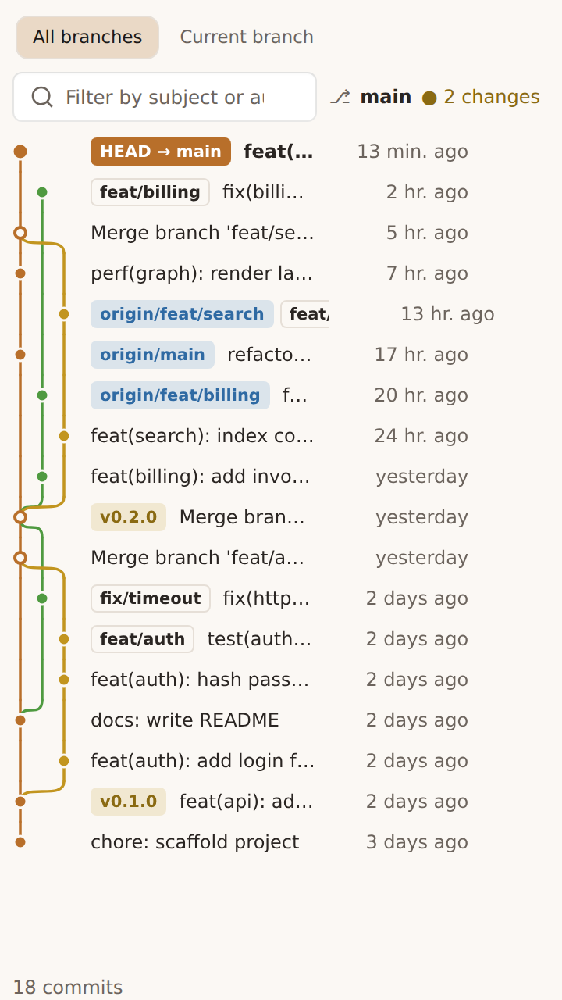
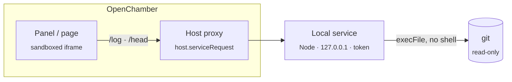

<div align="center">

# Git Graph

**See what your agents committed without leaving OpenChamber.**

A live, read-only git history graph for the project open in [OpenChamber](https://github.com/openchamber/openchamber): colored lanes, merges, branches and tags, one click from each commit's diff.


<br />

<picture>
  <source media="(prefers-color-scheme: light)" srcset="docs/screenshots/page-light.png" />
  
</picture>

</div>

---

## Why

You run several coding agents in parallel. Commits land while you are not typing: an agent finishes its turn, another session rebases, you commit from a terminal. Git Graph keeps the history **up to date on its own** and readable in a narrow side panel, so you always know what happened, on which branch, and whether the working copy is dirty.

## Features

| | |
|---|---|
| 🌳 **Lane graph** | Deterministic lanes, merges and octopus merges, one color per lane taken from the theme. |
| 🏷️ **Ref badges** | `HEAD`, local and remote branches, tags, each with its own style. |
| ⚡ **Hot reload** | Follows new commits, branches, checkouts and fetches with no click. Only what moved is read again. |
| 🔍 **Filter & paginate** | Text filter on subject and author, *All branches* / *Current branch* tabs, pages of 500 commits. |
| 🧭 **Status line** | Current branch (or detached HEAD) and the number of uncommitted changes. |
| 🖱️ **One-click diff** | Click or <kbd>Enter</kbd> on a commit opens its diff in OpenChamber; *Copy* puts the full hash on the clipboard. |
| 🌗 **Theme & language** | Follows OpenChamber's light/dark theme. English and French interface. |
| 🔒 **Read-only by design** | Never writes to the repository and never locks it while your agents use git. |

<table>
  <tr>
    <td align="center" width="50%"><br /><sub>Side panel, dark theme</sub></td>
    <td align="center" width="50%"><br /><sub>Side panel, light theme</sub></td>
  </tr>
</table>

## Quick start

> [!NOTE]
> Requires OpenChamber **1.24.0** or later and `git` on the machine running OpenChamber.

1. Clone the repository:
   ```sh
   git clone git@github.com:MltStephane/openchamber-git-graph.git
   ```
2. In OpenChamber (web or desktop), open **Settings → Extensions**, paste the absolute path of the folder, then click **Add**.
3. **Approve the local service** the extension declares: it runs `git`. Without this approval, the panel shows *Local service not allowed*.
4. Click the <kbd>git-merge</kbd> icon on the rail for the **panel**, or open the **full-screen page** from the *Extension pages* menu above the session list.

> [!TIP]
> The built files (`panel/main.js`, `service/main.js`) are committed: OpenChamber compiles nothing. After changing the sources, run `npm run build`, then reload the extension.

## Using it

- **Open a diff**: click a commit, or focus it and press <kbd>Enter</kbd>.
- **Copy a hash**: the *Copy* button copies the full hash, ready for `git cherry-pick` or a PR.
- **Inspect a commit**: hover a row for the full hash, author, absolute date and subject.
- **Narrow the history**: switch between *All branches* and *Current branch*, or type in the filter. While a filter is active, lane lines are hidden (they would lie about ancestry) and only each lane's colored dot remains.
- **Go further back**: *Load 500 more* at the bottom of the list.

## How it works



The page runs in a sandboxed iframe with no network and no access to git. It goes through `host.serviceRequest` to a local Node service that OpenChamber starts (`contributes.service`, see `GUEST_SERVICES.md` in `@openchamber/sdk`). The service listens on `127.0.0.1`, requires the `OPENCHAMBER_SERVICE_TOKEN` token, and runs git through `execFile` (no shell) with `GIT_OPTIONAL_LOCKS=0`: read-only, no injection possible through the parameters.

**Hot reload.** The graph reloads when the project changes. While the panel is visible, `/head` is polled every 3 s; the log is read again only when the refs, HEAD or the current branch change, otherwise only the status line is updated. Polling pauses on error until you click *Retry*.

### Service API

| Route | Parameters | Response |
|---|---|---|
| `GET /health` | | `{ ok: true }` |
| `GET /log` | `dir` (absolute), `limit` (1–2000, default 500), `skip` (default 0), `scope` (`all` \| `current`) | `{ commits: [{ hash, parents, refs, author, timestamp, subject }], hasMore }` |
| `GET /head` | `dir` | `{ branch, sha, dirty, changes, refs }` (`refs`: sha1 fingerprint of `git for-each-ref` and HEAD) |

Errors: `{ error, message }` with `400 bad-request` (non-absolute path), `422 no-directory` / `422 not-a-repo`, `500 no-git` / `git-failed`. A repository without commits returns an empty list.

`/log` runs `git log --topo-order --date-order --decorate=full --all` (or `HEAD`). Both ordering options are passed; git applies the last one (`--date-order`), which also guarantees that a child always comes before its parents, the only condition the lane algorithm needs.

### Lane algorithm

`src/graph.ts` is deterministic and makes a single pass over the commits, from newest to oldest:

1. a commit takes the leftmost lane waiting for it, otherwise the leftmost free lane;
2. its first parent keeps that lane;
3. every other parent (merge, octopus) reuses the lane already waiting for it, otherwise opens the leftmost free lane;
4. the other lanes waiting for this commit converge to it and close;
5. a root commit closes its lane.

## Development

```sh
npm install
npm run build      # panel/main.js (browser IIFE) + service/main.js (Node ESM), via openchamber-guest-bundle (Bun)
npm test           # bun test
npm run typecheck  # tsc --noEmit
```

The tests cover lanes (linear, branch + merge, octopus, multiple roots, continuity over 200 random DAGs), log parsing, i18n, the hot-reload decision, the service client, error mapping, the filter, dates and graph geometry.

Test the service by hand:

```sh
OPENCHAMBER_SERVICE_PORT=47999 OPENCHAMBER_SERVICE_TOKEN=t node service/main.js &
curl -H 'Authorization: Bearer t' 'http://127.0.0.1:47999/log?dir=/path/to/repo&limit=5'
```

<details>
<summary><strong>Project layout</strong></summary>

```
package.json                  manifest (openchamber.contributes: panel, page, service)
panel/index.html              page loaded in the iframe
panel/main.js                 IIFE bundle (built)
service/main.js               local service (built)
src/graph.ts                  lane algorithm
src/log-format.ts             git log format and parsing (shared by service / tests)
src/service-contract.ts       page size, limit, answer shapes and error codes shared by service and panel
src/service.ts                local HTTP service
src/panel/main.ts             panel orchestration: state, loading, rendering, polling
src/panel/service-client.ts   /log and /head through host.serviceRequest, answers checked against the contract
src/panel/problems.ts         service and host errors mapped to what the panel shows
src/panel/filter.ts           text filter on subject and author
src/panel/dates.ts            relative and absolute dates
src/panel/graph-geometry.ts   row and lane sizes, lane colours, SVG paths, dot kind (no DOM)
src/panel/view.ts             SVG rendering, badges, styles
src/panel/watch.ts            hot reload: what to read again when /head changes
docs/screenshots/             README screenshots
test/                         bun tests
```

</details>
